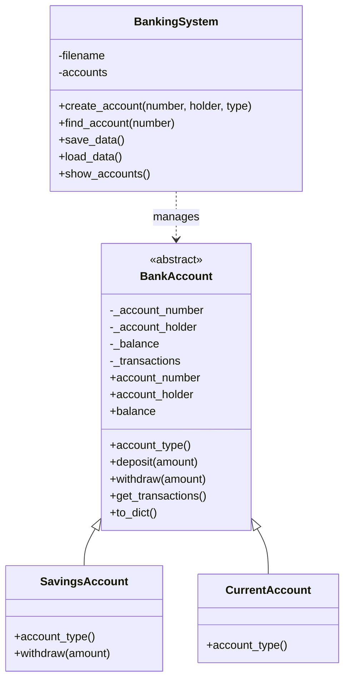

# Class Diagram and Application Design

## Class Diagram

## Design Explanation

- **BankAccount:** Abstract parent class. It stores common account information and provides deposit, withdrawal, and transaction-history methods.
- **SavingsAccount:** Child class that applies a minimum balance rule of Rs. 500.
- **CurrentAccount:** Child class that allows withdrawals up to the available balance.
- **BankingSystem:** Creates and manages accounts and saves information to a JSON file.

## Application Flow

1. The program starts and loads saved account information.
2. The user selects an option from the menu.
3. The banking system finds the requested account.
4. The account performs the selected operation.
5. Transactions are recorded and saved to the JSON file.
6. The program continues until the user selects Exit.

## OOP Principles

- **Encapsulation:** Account data is kept inside the account class and accessed through properties and methods.
- **Inheritance:** Savings and current accounts reuse the BankAccount class.
- **Polymorphism:** Account subclasses implement account-specific behavior.
- **Abstraction:** The abstract BankAccount class defines a common structure for all account types.
